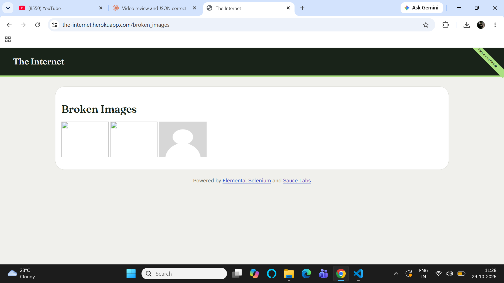
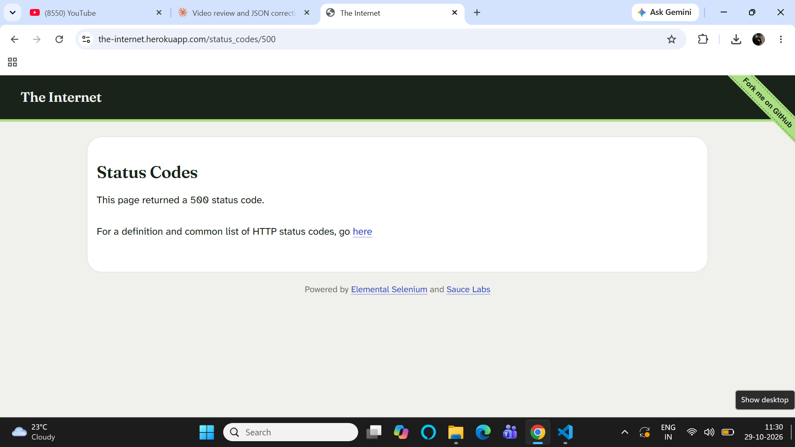
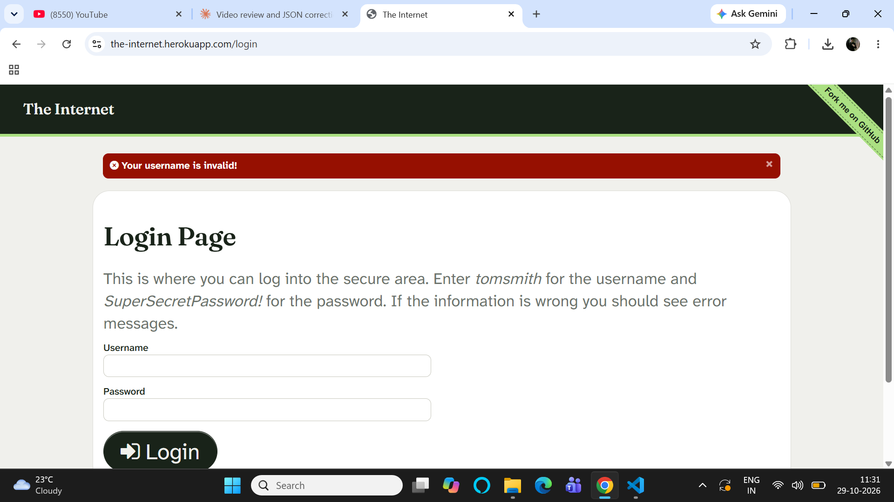
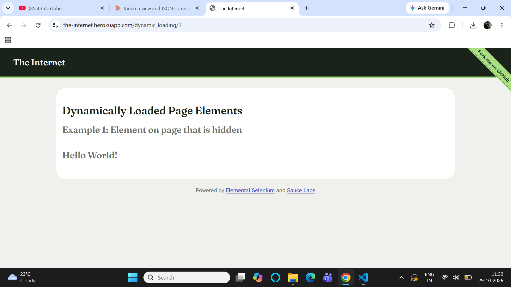
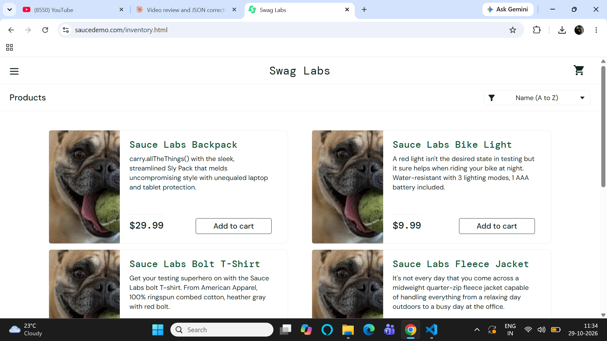

# Bug Reports

---

## BUG-001: Images fail to load on Broken Images page

**Severity:** Major
**Priority:** Medium
**Environment:** Chrome on Windows 11
**Status:** Open

**Steps to Reproduce:**
1. Go to https://the-internet.herokuapp.com/broken_images
2. Observe the three images displayed on the page

**Expected Result:**
All three images should load and render correctly on the page.

**Actual Result:**
All three images fail to load and show a broken image icon instead.

**Screenshot:**

---

## BUG-002: Clicking the 500 status code link returns a server error with no user-friendly message

**Severity:** Critical
**Priority:** High
**Environment:** Chrome on Windows 11
**Status:** Open

**Steps to Reproduce:**
1. Go to https://the-internet.herokuapp.com/status_codes
2. Click the link labeled "500"

**Expected Result:**
The application should handle the error gracefully and show a clear, user-friendly error message.

**Actual Result:**
The page displays a raw "This page returned a 500" message with no further guidance or navigation option back to the main flow.

**Screenshot:**

---

## BUG-003: Login form does not clearly indicate which field caused the error

**Severity:** Minor
**Priority:** Low
**Environment:** Chrome on Windows 11
**Status:** Open

**Steps to Reproduce:**
1. Go to https://the-internet.herokuapp.com/login
2. Leave both Username and Password fields empty
3. Click the Login button

**Expected Result:**
The form should visually highlight which specific field(s) are missing/invalid (e.g. red border on the empty field).

**Actual Result:**
A generic error message appears at the top of the page ("Your username is invalid!"), but neither input field is visually marked, making it harder for a user to immediately see what to fix.

**Screenshot:**

---

## BUG-004: No loading indicator shown before "Start" triggers dynamic content

**Severity:** Trivial
**Priority:** Low
**Environment:** Chrome on Windows 11
**Status:** Open

**Steps to Reproduce:**
1. Go to https://the-internet.herokuapp.com/dynamic_loading/1
2. Click the "Start" button
3. Observe the page immediately after clicking, before "Hello World!" appears

**Expected Result:**
A clear loading indicator (spinner/progress bar) should be visible immediately after clicking Start, so the user knows the system registered the click.

**Actual Result:**
There is a brief visible loading bar, but it's small and easy to miss — on a slower connection this could make users think the button click didn't register, and click it again.

**Screenshot:**

---

## BUG-005: Product images are mismatched for problem_user account

**Severity:** Major
**Priority:** Medium
**Environment:** Chrome on Windows 11
**Status:** Open

**Steps to Reproduce:**
1. Go to https://www.saucedemo.com
2. Log in with username `problem_user` and password `secret_sauce`
3. Observe the product images on the inventory/products page

**Expected Result:**
Each product should display its own correct, unique image.

**Actual Result:**
All product images appear identical/swapped — every item shows the same picture (a red shirt image) instead of its actual product photo.

**Screenshot:**

--- 
